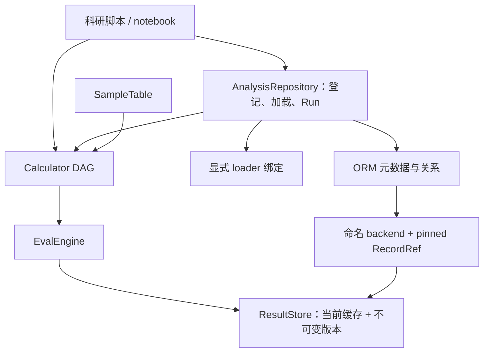

# pynbodyext V1 设计修订：以现有执行链补齐对象与结果追踪

**Integration update / 集成更新 — 2026-11-09:** All authorized increments are now merged; work items are done. See the [integration record](integration-2026-11-09.md) for actual PRs and verification. Earlier local-only statements below describe the recorded pre-integration checkpoint.

日期：2026-11-09。原审查基线：`5df15dd`；下述状态已更新为本次本地实施结果，
尚未提交或合并。已批准合同见 ADR-011–019；当前公共契约以 `CONTEXT.md`、
各项双语 spec 和测试为准，原基线问题保留在单独的审查报告中。

## 1. 目标与约束

核心目标仍是从模拟输入回溯到分析过程和保存结果。近期应把已有链条做完整：
登记输入 → 显式加载 → Calculator DAG → ResultStore 固定版本 → ORM Run → 查询。
不为了目录图整齐而重新实现 DAG、执行器、签名、结果编解码和显示系统。

沿用 [既有决策](decisions.md)：ORM 管元数据，ResultStore 管载荷；revision 可选；
路径不是逻辑身份；保存版本不可覆盖；缓存命中也产生 Run；独立存储之间允许部分
失败，并由用户选择准确回执恢复。没有旧数据库迁移需求。完整/轻量发行已按
ADR-019 实现：core 独占代码，full 为强制依赖同版本 core 和 SQLAlchemy 的元包。
实际安装、旧单包迁移及未验证平台见[安装矩阵](installation-matrix.md)。

V1 不纳入分布式调度、自动科学对象匹配、自动历史 GC、任意插件代码的安全反序列化、
全部拟合算法或 MCP 服务。SQLite 以外方言、跨平台 native 构建单独验证。

## 2. 当前实现与需求映射

| 原始需求 | 核验后的状态 | 证据 / 下一步 |
|---|---|---|
| 组合 Property/Filter/Transform、Pipeline | 已实现；公共 Filter 值为布尔 mask | `nodes/`、`test_calculate_contract.py`；不扩展为任意 slice/family 返回值 |
| 稳定可重建计算定义 | 已有 CalculatorSignature；stable 与 constructible 独立 | `result/signature.py`、签名系列测试；名称仅用于显示 |
| 与路径解耦的输入身份 | 已实现显式逻辑 provider | FEAT-0002；仍不自动发现快照或检测原地修改 |
| 保存标量、数组、单位 | 已修复对象数组；支持可无损 NPY 表达的无 object 结构化数组 | BUG-0010/0011；metadata 等不支持布局在编码前拒绝 |
| 历史结果和刷新 | 已实现不可变版本 | FEAT-0001；相同计算刷新会新增版本，不承诺载荷字节去重 |
| ORM 对象与 Run 关联 | 已实现 Simulation/Timestep/DataObject/Recipe/Run/ResultLink | FEAT-0003；无 RunStep 和多输入关联 |
| 从登记对象加载 | 已实现本地根快照 | FEAT-0004；缓存命中也调用 loader |
| Catalogue/Halo/Subhalo 命名空间 | 已实现元数据、类型化编号与同目录 host 约束 | FEAT-0009；尚不加载 catalogue 对象 |
| 派生容器重新加载 | 已实现显式 SelectionSpec 与 Run.selection_id | FEAT-0010；遵循根 family 块顺序，跨块重排拒绝 |
| 后处理器 | 已实现 PostprocessorBase.process(value) | FEAT-0008；复用 DAG，清理边界见 §6.1 |
| 外部文件结果 | 已实现冻结描述符与显式检查 | FEAT-0007；不保存或恢复外部字节 |
| 环境与工具版本追踪 | 已实现 Run.execution_context 调用环境快照 | FEAT-0006；缓存命中不冒充旧载荷生成环境 |
| 多对象表 | 已实现固定单元格引用与错误恢复 | BUG-0012、FEAT-0005；仍逐列执行 |
| 脚本/跨进程重放 | 已实现根输入 JobSpec JSON 重放 | FEAT-0011；显式注册类型、默认 RunOptions，不自动导入插件 |
| ORM 支持批量样本分析 | 已实现串行 run_study 与 StudyReport | FEAT-0012；每格独立 Run，持久化失败立即停止 |
| 安装与发布 | 已实现 core/full 发行与本机实际安装矩阵；未发布 | SPIKE-0001、TASK-0002；未运行的平台不计认证 |
| MergerTree、目录自动发现、具体拟合包、MCP | 仍为后续需求 | §8 明确启动条件，不能算 V1 当前完成 |

代码路径中 `nodes/`、`result/`、`runtime/`、`store/` 均相对于
`pynbodyext/core/calculate/`；测试均位于 `tests/`。

## 3. 保留的架构

`orm` 依赖计算层；计算层不反向导入 ORM。plot/image 仍处理通用数组。扩展通过
现有分层契约和明确的公共 seam 完成，不增加向上依赖白名单。

| 概念 | 当前权威对象 | 本轮约束 |
|---|---|---|
| 计算定义 | Calculator DAG / CalculatorSignature | ORM Recipe 仅记录 hash + JSON，不是第二套 Recipe 编译器 |
| 实际计算结果 | Result | 保留值、named outputs、诊断与 `store_ref` |
| 序列化载荷 | ResultRecord / ValueCodec | “ResultData”暂作为需求总称，不新增重复大容器 |
| 保存地址 | RecordRef | 计算地址与保存版本区分；引用必须连同 backend 定位 |
| 运行审计 | ORM Run / RecordedRun | 每次调用一个 Run；不把缓存条目当运行 |
| 输入位置 | DataLocation + Run.execution_context | 位置元数据可变；Run 另存选中 URI/loader/revision 的调用快照 |

## 4. 已修复的合同缺陷

**BUG-0010：object 数组。** 原先 `tolist()` 后重建 `np.array(..., dtype=object)`
会把元素内列表误认为新维度；零维失败，空数组丢失维数。保存 shape 和按 C 顺序的
逐元素编码；按保存 shape 预分配 object 数组并逐元素赋值，避免 NumPy 再次推断维度。
单位不能在 object SimArray 分支丢失。非法 shape/元素数不一致须明确拒绝。

**BUG-0011：structured dtype。** `str(dtype)` 不能可靠地被 `np.dtype` 解析。
为不含 Python object 的 structured ndarray 使用专门的 NPY 编码分支，读写都关闭
pickle；普通数值数组分支保持原有格式。验收字段名、嵌套字段、subarray、byte order、
offset/itemsize 与值；含 object 字段的 structured dtype 本增量在编码前明确拒绝，
不能把对象指针原始字节保存。dtype metadata（含嵌套字段 metadata）和 NPY 无法
无损表示的布局在编码阶段报清晰错误，不能仅丢掉 metadata 后返回成功。

**BUG-0012：恢复后的错误状态。** `fill_from_store()` 成功填值时必须清掉对应旧错误，
miss 时保留；读取失败不能伪装成成功。具体复现与回归步骤见工作项。

这些是已有行为的修复，不需要重新决定总体架构；实现仍按仓库要求先红后绿，
涉及公共行为运行 `make check` 与 `make test-all`。

## 5. 已实现的结果追踪合同

### 5.1 SampleTable 的固定来源（FEAT-0005）

已新增 `SampleRow.refs: dict[str, RecordRef]`，只存实际返回的 pinned ref。
`add` / `fill_from_store` 同时更新 value、error、ref；失败或成功但未持久化时移除
该格旧 ref。表级增加可空 `store_name`，它是调用者提供的 backend 名称，不含连接串。
无名称的表可以保存 ref，但重开后只能在显式传入原 store 时解析，不能猜测 backend。

JSON 新 schema 保存每格 `RecordRef.to_json()` 及表级 store_name。`load` 只恢复值和
引用，不查询 backend、不刷新；显式 `store.fetch(row.refs[label])` 才读取旧版本。
`where` 保留 refs 与 store_name；DataFrame 元数据保留类型化行身份和 refs，不能用
非唯一显示行名覆盖身份。本阶段仍逐列执行，不承诺共享跨列依赖。

成功的 `None` 值与“缺失”目前共用哨兵。本轮不借引用改造扩大为完整 cell 状态机；
文档明确此限制，若要支持可查询的成功 None，应另设状态合同及工作项。

### 5.2 环境与执行输入快照（FEAT-0006）

为 ORM Run 增加 versioned JSON 的 `execution_context`：Python、pynbodyext、NumPy、
pynbody、已加载 native 信息（可空）、调用者显式 tool_versions/random_seed，以及
选中 location 的 URI、loader_id、revision 的值快照。只记录已知值；不扫描环境变量、
不导入所有插件、不执行 Git 命令。记录 random_seed 不等于替调用者设置随机种子。

在 begin_run 时提交此快照，失败也保留。cache hit 上记录的是此次调用环境；
载荷仍归原固定版本，不能把新环境冒充为生成旧结果的环境。已有载荷缺少环境时
明确 unknown；本阶段不修改计算签名或自动失效策略。未来 payload producer 环境
需单独扩展 ResultRecord，不能通过 Run 的 consumed 环境推断。

### 5.3 外部文件引用（FEAT-0007）

已实现冻结值类型 `ExternalFileRef(uri, media_type, size_bytes=None, sha256=None)`，
由 ValueCodec 明确 tag/schema 编码；首版只引用用户拥有的本地绝对路径。
构造、编码、解码不读文件。显式 `inspect()` 才返回 available/missing/changed，
`verify_checksum=True` 才计算哈希。没有 checksum 时不声称内容一致。

ResultStore 版本固定的是描述符，不能让外部文件本身变得不可变。用户要历史文件
可重现，应提供不覆盖的版本化路径并可记录校验值。V1 不自动搬移、删除、GC、下载、
自动按大小转存或验证远端 URI。普通字符串继续是字符串。

## 6. 已实现的科学对象与组合合同

### 6.1 Postprocessor（FEAT-0008）

首版只支持 Calculator 上游，source 是唯一动态字段，其余配置为静态参数，复用
`Param` 的现有依赖解析：
`PostprocessorBase` 的科学 hook 为 `process(value)`，由通用适配层接收 runtime
并传入已求值的上游值。process 不接收 SimSnap，也不再次调用上游 `.run()`。
上游签名、参数、子类 signature_version 都进入现有 CalculatorSignature。

同一 Pipeline 内共享上游只算一次；单位、错误收集和存储沿用 EvalEngine。
适配器在 process 异常时清理自己已应用的 bound scope，遵循 revert 策略；不调用
继承祖先的 cleanup。native compound handle 仍可能级联回退，NEVER 与祖先句柄的
组合限制见 ADR-014。进入适配器前的 apply/filter 失败及通用成功清理不在此次修复范围。
先用简单数值归一化/缩放作为契约示例，不直接引入 Sersic/
isophote 依赖。直接接受持久 ResultRef 的后处理涉及跨 backend、来源与输入身份，
本阶段明确拒绝，后续单独定义多输入模型。

### 6.2 Catalogue 与对象身份（FEAT-0009）

先做可查询元数据，再做数据加载。Catalogue 隶属一个根 DataObject，带显式
`catalogue_id`、finder、revision、loader_id；同根输入下完整 catalogue 身份唯一。
CatalogueObject 按 catalogue + kind(halo/subhalo) + typed object key 唯一，外部编号
`1`、`"1"`、`True` 不合并。允许 subhalo 没有已知 host；有 host 时须同 catalogue、
同根、host 是 halo，不推断科学上的跨目录等价性。`DataObject.parent` 继续表示根
来源，物理 host 另设关联，不能混成一棵父树。

此任务不把 catalogue 编号直接塞入旧 snapshot provider 后缀，不改变已有缓存键，
不提供假装可加载的对象，也不加载整份 halo catalogue 来创建全部行。

### 6.3 显式可重建选择（FEAT-0010）

首版仅支持根 snapshot 的 `indices` / `family` / 稳定可重建 Filter 三种
SelectionSpec；CatalogueObject 加载另一个增量处理，避免同时解决 finder API。
描述符包含根 input ID、原根粒子数、selection schema 和定义；Selection 行分别
保存定义与实际 view input，Run.selection_id 记录采用的定义。两个定义可产生同一
view，不能因此互相覆盖。indices 是根相对
整数索引，保留每个 family 块内的顺序和重复，bool mask 必须另行明确转换。
用户已批准 pynbody 2.8 的 family 顺序约束：块顺序必须遵循根 snapshot，跨块重排
或交错明确拒绝，绝不静默排序；依据见 ADR-016 和 FEAT-0010 的 family-order-decision.md。

加载时先按 FEAT-0004 加载根，校验父身份和粒子数，再重建选择，最后用 provider
验证实际 subset identity 与登记期身份一致。Filter 在原坐标系求值；显式外部
Transform 的输入不允许登记为可重建选择。粒子数和索引摘要都不能检测同数量重排；
强保证需要调用者 revision/排序标识，本阶段不得宣传自动识别任意数据变化。
无描述符的历史 view 继续在 load_input 预检拒绝，不试图逆向摘要。

## 7. 已实现的重放、批处理和发行合同

**FEAT-0011：根快照 job manifest。** 新 `pynbodyext.orm.jobs` 保存版本化 JSON：
`calculator_signature_text`、`input_id`、可空 `location_id`、store_name、reuse。
初版只支持默认 RunOptions，避免序列化回调/任意对象；未知字段、未知 schema、
session/unstable/nonconstructible recipe 在保存或执行预检拒绝。manifest 的 ID
明确是某个 metadata repository 的本地 ID；必须显式绑定同一 repository，不声称
可直接跨数据库迁移。绑定凭据、callable、live SimSnap 和 `_EvaluationPlan` 不落盘。
执行委托 `run_input`，不创建第二执行器、不绕过加载、不自动安装/导入第三方插件。

**FEAT-0012：登记输入的批量研究。** ORM 外层串行遍历 input × calculator，调用
`run_input`，每格保存 run_id、值/错误、pinned ref，返回独立的 StudyReport。
不让 core SampleTable 反向依赖 ORM。失败继续只用于已正确登记为 failed 的计算错误；
RunPersistenceError 必须停止并保留回执供恢复。checkpoint 是报告，不是 exactly-once
承诺；重新调用仍产生新 Run，缓存可复用。首版不做并行与跨列 DAG 优化。

**SPIKE-0001 + TASK-0002：安装与发布。** 用户已批准 `pynbodyext-core` 独占全部
Python/native/CSS，`pynbodyext` 仅为依赖同版本 core 和 SQLAlchemy 的完整元包。
已验证本机 Linux x86_64 / Python 3.11.9 的实际 wheel/sdist、干净环境、native
可用/不可用、卸载归属和源码安装；未运行的 macOS/Windows 与其他 Python 组合
明确列为未验证。旧同版本单包须先卸载再装新包对，直接 pip upgrade 未通过归属验证。
没有名称保留或远端发布；完整证据与命令见[安装矩阵](installation-matrix.md)。

## 8. 范围保留与后续启动条件

| 需求 | 当前处置 | 启动条件 |
|---|---|---|
| 从目录发现快照、登记模拟参数/宇宙学时间 | 保留，当前用显式登记 | 选择一套真实目录 fixture、格式与时间单位策略 |
| CatalogueObject 的 pynbody 加载 | 在元数据模型后单独设计 | 选定 finder/版本、编号和 host/subhalo 读取合同及真实 fixture |
| MergerTree 与跨快照追踪 | 保留后续阶段 | 明确多前驱/后继、主分支含义和一种导入格式 |
| Sersic/isophote/SKIRT | 后处理协议稳定后逐工具接入 | 确定首个科学用例、参考结果、拟合约束和误差验收 |
| fingerprint/过时检测 | 保留显式可选校验 | 先决定多文件覆盖范围、算法和成本；快照不会默认全量哈希 |
| 任意 pickle / codec registry | 可信本地值沿用现状 | 引入跨信任边界前定义 opt-in 和可扩展注册合同 |
| RunStep / 多输入结果后处理 | 暂不加表 | 出现明确节点查询或多个 pinned 输入用例 |
| 历史 GC / 多库共享 payload | 暂不删除 | 定义全局引用范围、保留期限和 dry-run 审查合同 |
| 公共 Workspace / 独立 Plan | 不是当前交付前置 | 现有入口重复编排已被具体用例证明，而非仅目录偏好 |
| 并行/native 新优化 | 现有算法保留 | 性能基线证明热点，科学正确性对照和回退策略明确 |
| MCP / agent 服务 | V2 | 稳定输入/结果/重放合同、资源与权限边界完成 |

上述项目不是“需求取消”或“已经完成”，也不是可直接让实现者自行选择科学语义的
任务。详细任务队列覆盖本次可定义的增量；启动条件未满足的需求保留在本表。

## 9. 完成与审查标准

每个实现工作项有独立验收、失败场景、文件范围和 red → green 证据。旧契约测试保留，
设计变更先记录再改代码。新功能先做一个可运行的纵向切片：SQLite 重开、历史引用、
失败恢复和纯计算导入边界均需覆盖。新功能不存在不能作为现有基线失败报告；新增
失败测试在后续对应实现任务中提交。

顺序和原始交接指令见[实施入口](implementation-roadmap.md)。本轮已在批准合同内
逐项本地实现 BUG-0010–0012、FEAT-0005–0012 和发行拆分；各项仍待审阅/合并。
§8 后续需求不属于此次完成范围，未承诺数据库迁移、跨平台认证或远端发布。
